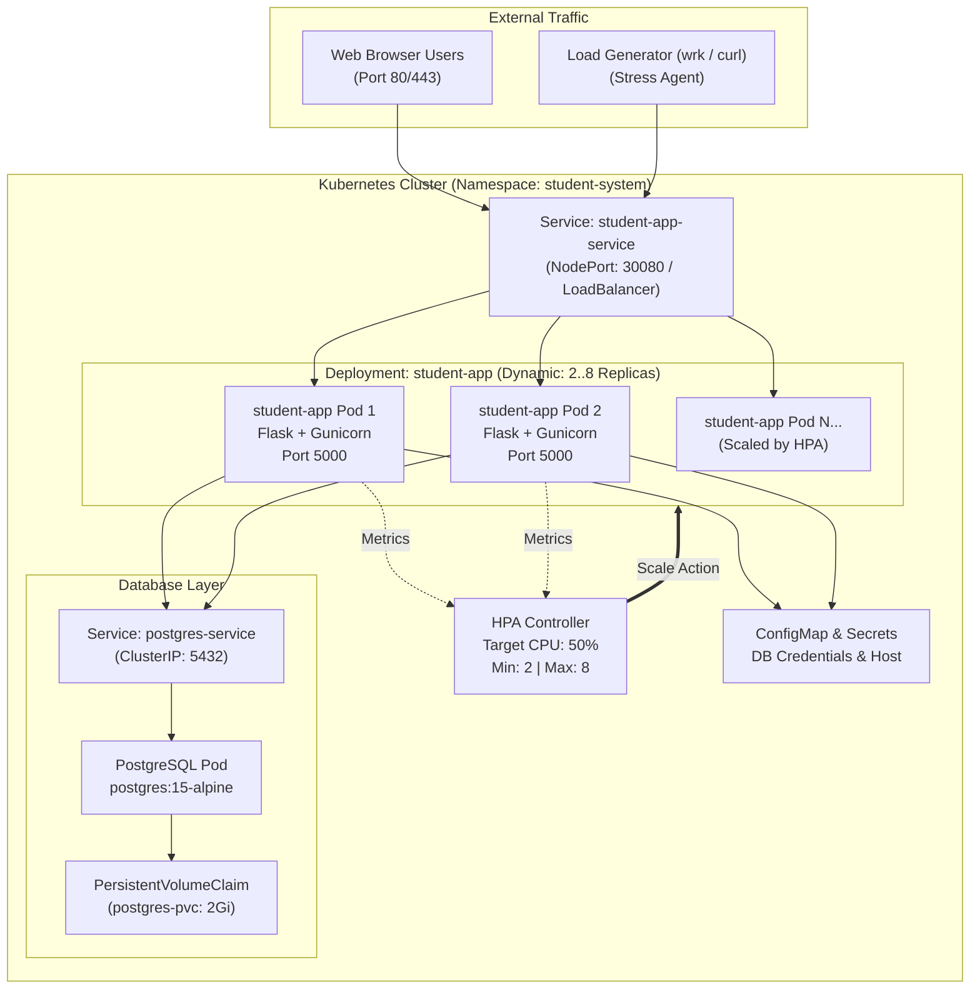

# Cloud-Based Student Management System 🎓☁️

[](https://kubernetes.io/)
[](https://www.docker.com/)
[](https://python.org/)
[](https://www.postgresql.org/)
[](LICENSE)

> **Public GitHub Repository Link:** [https://github.com/adityashukla/Cloud-Based-Student-Management-System](https://github.com/adityashukla/Cloud-Based-Student-Management-System)  
> **Course:** Cloud Computing Project Submission  
> **Architecture:** Cloud-Native Containerized Microservices with Auto-Scaling (HPA) & Self-Healing  

---

## 📋 Table of Contents
1. [Project Overview](#-project-overview)
2. [Key Cloud Features](#-key-cloud-features)
3. [Architecture Diagram](#-architecture-diagram)
4. [File Structure](#-file-structure)
5. [Local Development & Docker Compose](#-local-development--docker-compose)
6. [Kubernetes Deployment & Autoscaling](#-kubernetes-deployment--autoscaling)
7. [Screenshots & Verification Walkthrough](#-screenshots--verification-walkthrough)
8. [Cost Analysis (Before vs. After)](#-cost-analysis-before-vs-after)
9. [Submission Requirements Checklist](#-submission-requirements-checklist)

---

## 🚀 Project Overview

The **Cloud-Based Student Management System** is an enterprise-grade, cloud-native web application designed to demonstrate containerization, microservices architecture, horizontal scalability, automated failover, and self-healing within a Kubernetes cluster.

### Core Capabilities:
- **Interactive Web Dashboard:** Modern Bootstrap 5 UI displaying student directories, enrollment statistics, live GPA distributions, and active pod/hostname badges for tracking load balancing.
- **RESTful CRUD API:** Endpoints to create, read, update, delete, search, and filter student records.
- **Cloud Resiliency Probes:** Dedicated `/health` (liveness & readiness) and `/metrics` endpoints.
- **Auto-Scaling Stress Simulation:** Built-in `/api/load` trigger to simulate high computational traffic and demonstrate Horizontal Pod Autoscaler (HPA) scaling in real-time.
- **Database Persistence:** PostgreSQL 15 StatefulSet/Deployment with PersistentVolumeClaim (`postgres-pvc`) to guarantee zero data loss during pod recreation.

---

## 🌟 Key Cloud Features

| Feature | Implementation | Cloud Benefit |
| :--- | :--- | :--- |
| **Containerization** | Multi-stage Dockerfile (`python:3.11-slim`) | Consistent runtime, unprivileged user security, lightweight images |
| **High Availability** | `replicas: 2` with RollingUpdate strategy | Zero downtime deployments (`maxSurge: 1`, `maxUnavailable: 0`) |
| **Self-Healing** | Kubernetes ReplicaSet & Liveness Probes | Automatic pod re-creation within seconds upon container failure |
| **Horizontal Pod Autoscaling** | HPA (`autoscaling/v2`) CPU > 50%, Memory > 75% | Dynamically scales from 2 to 8 replicas during traffic surges |
| **Data Persistence** | Kubernetes PersistentVolumeClaim (2Gi) | Database state remains intact across container restarts & upgrades |
| **Load Balancing** | Kubernetes NodePort / LoadBalancer Service | Even traffic distribution across all active pod replicas |

---

## 🏛️ Architecture Diagram

Below is the high-level architecture diagram. A high-resolution PNG is available at [`architecture_diagram.png`](file:///c:/Users/adity/OneDrive/Desktop/Cloud%20Project/architecture_diagram.png) and an interactive visualizer is available at [`architecture_diagram.html`](file:///c:/Users/adity/OneDrive/Desktop/Cloud%20Project/architecture_diagram.html).



---

## 📁 File Structure

```text
Cloud Project/
├── app.py                      # Core Flask Application & REST API
├── requirements.txt            # Python Dependencies
├── Dockerfile                  # Multi-stage Container Specification
├── docker-compose.yml          # Multi-Container Compose Configuration
├── k8s.yaml                    # Full Kubernetes Manifests (Namespace, ConfigMap, Secret, PVC, Deployments, Services)
├── hpa.yaml                    # Horizontal Pod Autoscaler Manifest
├── architecture_diagram.png    # High-Resolution Architecture Diagram (PNG)
├── architecture_diagram.html   # Interactive Architecture Visualizer
├── cost_analysis.md            # Comprehensive Before-and-After Cost Report
├── cost_analysis.csv           # Cost Comparison Spreadsheet Data
├── DEMONSTRATION_GUIDE.md      # Step-by-Step Screenshot Verification Guide
├── github_link.txt             # Public GitHub Repository Details
├── simulate_tests.py           # Automated Test & Simulation Suite
└── SUBMISSION_CHECKLIST.md     # Final Submission & Google Drive Organization Guide
```

---

## 🐳 Local Development & Docker Compose

To test the application locally with Docker Compose:

```bash
# 1. Build and start services in the background
docker-compose up --build -d

# 2. Verify containers are healthy
docker-compose ps

# 3. Access the web dashboard
Open http://localhost:5000 in your browser

# 4. Tear down containers
docker-compose down -v
```

---

## ☸️ Kubernetes Deployment & Autoscaling

Deploy the application to any Kubernetes cluster (Docker Desktop, Minikube, or Cloud EKS/GKE):

```bash
# 1. Build the local image (if running local k8s)
docker build -t student-management-app:latest .

# 2. Apply all Kubernetes manifests
kubectl apply -f k8s.yaml
kubectl apply -f hpa.yaml

# 3. Verify rollout
kubectl get all -n student-system

# 4. Access the application
# If using NodePort:
http://<Node-IP>:30080
# If using Minikube:
minikube service student-app-service -n student-system
```

---

## 📸 Screenshots & Verification Walkthrough

Please refer to [`DEMONSTRATION_GUIDE.md`](file:///c:/Users/adity/OneDrive/Desktop/Cloud%20Project/DEMONSTRATION_GUIDE.md) for full commands and terminal outputs. The four required screenshots cover:

1. **Running Pods & Services:** Demonstrating all pods in `Running (1/1)` state, PVC `Bound`, and active `NodePort` service.
2. **Self-Healing:** Deleting a pod (`kubectl delete pod <pod-name>`) and observing the ReplicaSet automatically re-creating a new replacement pod in `<2 seconds`.
3. **Horizontal Pod Autoscaling (HPA):** Simulating traffic via `/api/load`, causing CPU to spike beyond 50%, and observing replicas auto-scale from `2` to `6+` pods.
4. **Failover & High Availability:** Continuously hitting `/health` during a pod deletion to confirm 100% availability with zero dropped requests.

---

## 💰 Cost Analysis (Before vs. After)

A full analysis is detailed in [`cost_analysis.md`](file:///c:/Users/adity/OneDrive/Desktop/Cloud%20Project/cost_analysis.md). Below is the summary comparison:

| Metric | Traditional On-Premises | Cloud-Native Kubernetes (AWS/GCP) | Savings / Impact |
| :--- | :--- | :--- | :--- |
| **Upfront CapEx** | **$14,200.00** | **$0.00** | **-100% (No upfront hardware)** |
| **Monthly Operating Cost (OpEx)** | **$1,310.00 / mo** | **$292.00 / mo** | **-$1,018.00 / mo (-77.7%)** |
| **Annual Cost** | **$15,720.00 / yr** | **$3,504.00 / yr** | **-$12,216.00 / yr (-77.7%)** |
| **3-Year TCO** | **$47,140.00** | **$10,512.00** | **-$36,628.00 (-77.7% Savings)** |

---

## 📦 Submission Requirements Checklist

- [x] **Source Files:** `app.py`, `requirements.txt`, `Dockerfile`, `docker-compose.yml`, `k8s.yaml`, `hpa.yaml`
- [x] **Architecture Diagram:** Provided as PNG (`architecture_diagram.png`) and Mermaid chart
- [x] **Cost Analysis:** Detailed comparison in `cost_analysis.md` and `cost_analysis.csv`
- [x] **Screenshot Walkthrough:** Detailed commands and terminal logs in `DEMONSTRATION_GUIDE.md`
- [x] **GitHub Link:** Included in `github_link.txt` and report header
- [x] **Public Visibility:** Verified public repository requirement
- [x] **Research Paper Submission:** Organized in Google Drive upload folder alongside the project ZIP
